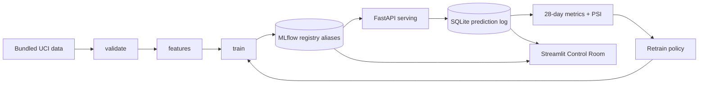

# mlops-lifecycle-lab

[Español](README.md) · **English**

[](https://github.com/Eduardo12Pacheco/laboratorio-mlops/actions/workflows/ci.yml)
[](https://github.com/Eduardo12Pacheco/laboratorio-mlops/releases)
[](LICENSE)
[](pyproject.toml)

**An end-to-end, local-first MLOps lifecycle on real hourly bike-rental demand data:**
validation → shared features → tracked training → champion/challenger registry → batch and
online serving → prediction logging → drift and performance monitoring → automated retrain
with statistical promotion gates → probation and rollback, proven by a reproducible drill.

> [Architecture](docs/ARCHITECTURE.md) · [Operations](docs/OPERATIONS.md) · [Model card](docs/MODEL_CARD.md) · [Data](docs/DATA.md)


## What it does

- **Contract-first data.** A pure validation engine runs 13 named rules; a bad batch is
  quarantined before it is scored or logged (never a silent bad prediction).
- **One feature function.** Batch and online paths call the same `build_features`, and a
  parity test proves they agree; leakage columns never reach the model.
- **Tracked training and an alias registry.** MLflow records params, metrics, tags, gate
  evidence and the model; lifecycle lives in `mll.stage` tags plus `champion`,
  `previous-champion` and `challenger` aliases, never deprecated stages.
- **Serving with hot reload.** FastAPI endpoints for single/batch predictions and delayed
  labels, a Prometheus `/metrics`, request ids and a champion that is swapped atomically.
- **Honest monitoring.** Trailing-28-day WAPE/RMSE/MAE/bias from labeled predictions are
  reported separately from covariate and prediction PSI against the champion's training
  window, so seasonality is visible without being mistaken for model harm.
- **Automated lifecycle.** A six-gate champion/challenger decision (data validity, absolute
  WAPE, baseline ratio, improvement, day-block bootstrap significance, segment regression),
  21-day probation, automatic rollback, a run ledger and a restart-safe replay scheduler.
- **A finished Control Room.** Five pages, light and dark, explicit loading/empty/error
  states and status conveyed by icon and label, never colour alone.

## Architecture



Hexagonal, typed Python 3.12: pure `domain`, `application` use cases over ports, adapters for
SQLite, MLflow, LightGBM, Evidently and HTTP, and a composition root that wires them. The
dependency direction is enforced by import-linter in CI; see
[docs/ARCHITECTURE.md](docs/ARCHITECTURE.md) and the [ADRs](docs/adr/).

## Quickstart

Docker path (Linux/macOS, needs Docker ≥ 24 and Compose v2):

```bash
git clone https://github.com/Eduardo12Pacheco/laboratorio-mlops && cd laboratorio-mlops
./install.sh
# Open http://127.0.0.1:14501 (MLflow: http://127.0.0.1:14000)
```

Windows PowerShell:

```powershell
git clone https://github.com/Eduardo12Pacheco/laboratorio-mlops; cd laboratorio-mlops
.\install.ps1
# Open http://127.0.0.1:14501
```

L1 without Docker (Python 3.12 + `uv`, no clone needed; each release also attaches the wheel):

```bash
uv tool install git+https://github.com/Eduardo12Pacheco/laboratorio-mlops
mll quickstart
mll dashboard
```

Run `./install.sh --check` (or `.\install.ps1 -Check`) for a side-effect-free prerequisite
report, and `mll doctor` for the same checks on the L1 path.

## Results

Every number below comes from a committed, reproducible drill run (seed 42, 52 weeks,
schema `drill-report/v1`); see [docs/results](docs/results) and
[docs/MODEL_CARD.md](docs/MODEL_CARD.md).

<!-- results:start -->
| Scenario | Weeks | Versions | Promotions | Rejections | Rollbacks | Quarantined | As-served RMSE | As-served MAE | As-served WAPE | Frozen-v1 RMSE | Frozen-v1 WAPE | RMSE ratio |
|---|---:|---:|---:|---:|---:|---:|---:|---:|---:|---:|---:|---:|
| drift | 52 | 3 | 1 | 1 | 0 | 0 | 70.7197 | 45.8888 | 0.1949 | 109.9249 | 0.3165 | 0.6433 |
| gate-reject | 24 | 3 | 1 | 1 | 0 | 0 | 66.8555 | 41.8600 | 0.1988 | 88.8282 | 0.2783 | 0.7526 |
| bad-batch | 12 | 1 | 0 | 0 | 0 | 1 | 70.3356 | 43.4195 | 0.2654 | 70.3356 | 0.2654 | 1.0000 |
| rollback | 25 | 3 | 2 | 0 | 1 | 0 | 84.8111 | 48.6398 | 0.2287 | 88.8369 | 0.2763 | 0.9547 |

_Generated by `uv run python scripts/render_results_table.py` from `docs/results/drill-*.json` (seed 42, schema `drill-report/v1`); do not edit by hand._
<!-- results:end -->

## The drift drill

```bash
mll drill run --scenario drift --weeks 52 --check
```

The drill replays 2012 week by week. Look for the trigger at the end of 2012-04-01 (28-day
WAPE `0.3086`), the promoted v2 (RMSE `53.27` vs champion `120.93`, a 55.95% improvement, bootstrap
lower bound `9000.84`), probation passing three ticks later and the final challenger rejected at
the end of the year. The automation cuts as-served 2012 RMSE from `109.92` (never-retrained
v1) to `70.72`. The full timeline is in
[docs/results/drill-drift.md](docs/results/drill-drift.md); `--scenario all` runs
`drift`, `gate-reject`, `bad-batch` and `rollback` in isolated workspaces.

Screenshots of every page in both themes live in
[docs/assets/screenshots](docs/assets/screenshots); they are captured from the real app by
`scripts/capture_screenshots.py`.

## Limitations

- Not a cloud service: no Kubernetes, managed services, auth system (only an optional admin
  API key), Grafana/Prometheus server or canary traffic splitting.
- "Production" is a replay of the dataset's 2012 half; no live data feed or feature store.
- The model is deliberately simple (one LightGBM Poisson model, no tuning/AutoML/deep
  learning); the lifecycle, not benchmark accuracy, is the product.
- Drift PSI is informational and never triggers a retrain; only label-based WAPE does, by
  design: in every 2012 weekly window at least half of the four weather features exceed PSI 0.2
  (seasonality, not model harm).
- The challenger is evaluated on a holdout and promoted without refitting on it, so the
  promoted artifact is exactly the evaluated one.
- Model artifacts execute code on load: the local registry is trusted state (see
  [SECURITY.md](SECURITY.md)).
- Reference numbers were produced on Linux x86_64; cross-OS floating-point differences can
  move the retrain tick by one week, which the golden tests tolerate explicitly.

## License and data

MIT © 2026 Eduardo Pacheco — see [LICENSE](LICENSE).
Data: UCI Bike Sharing dataset (Fanaee-T, 2013), CC BY 4.0, DOI
[10.24432/C5W894](https://doi.org/10.24432/C5W894), bundled unchanged as a gzip with its
checksums and attribution in [docs/DATA.md](docs/DATA.md).
