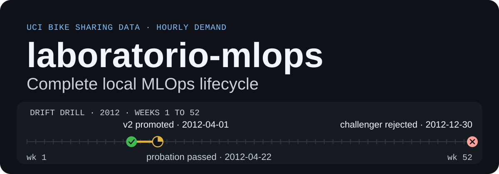
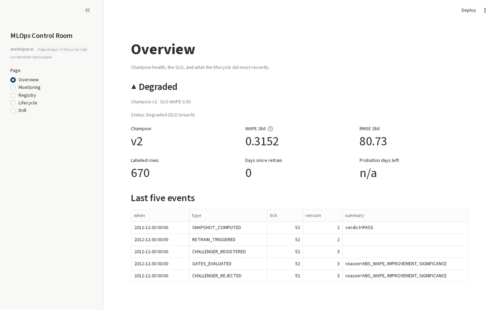
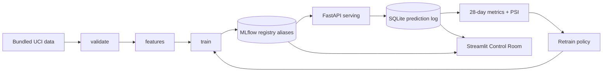

# laboratorio-mlops

[Español](README.md) · **English**

**A complete, local-first MLOps lifecycle on real hourly bike-rental demand, with automated retraining and rollback proven by a reproducible drill.**

[](https://github.com/Eduardo12Pacheco/laboratorio-mlops/actions/workflows/ci.yml)
[](https://github.com/Eduardo12Pacheco/laboratorio-mlops/releases)
[](LICENSE)
[](pyproject.toml)

<p align="center">
  
</p>



## What it is

A Python 3.12 MLOps lab that covers the full cycle on bike-rental data: validate, share features, train, register, serve, monitor drift and retrain behind statistical gates. It runs locally with Docker or `uv`.

**Status:** portfolio project, actively maintained; version 1.0.0 ([CHANGELOG](CHANGELOG.md)).

## Why it is different

- **Contract-first data.** A pure validation engine runs 12 named rules; a bad batch is quarantined before it is scored or registered.
- **One feature function.** Batch and online paths call the same `build_features`; a parity test proves they agree, and leakage columns never reach the model.
- **Gated promotion.** Six champion/challenger gates (data validity, absolute WAPE, baseline ratio, improvement, day-block bootstrap significance and segment regression), 21 days of probation and automatic rollback.
- **Separate monitoring.** WAPE, RMSE, MAE and bias from labeled predictions are reported apart from covariate PSI, so seasonality is not mistaken for model harm.
- **Alias-based registry.** MLflow stores parameters, metrics, gate evidence and the model; the lifecycle lives in `mll.stage` tags and the `champion`, `previous-champion` and `challenger` aliases, never in deprecated stages.

## How it works



Hexagonal, typed Python 3.12: pure `domain`, `application` use cases over ports, and adapters for SQLite, MLflow, LightGBM, Evidently and HTTP. A composition root wires them together; the service reloads the champion atomically, and import-linter enforces the dependency direction in CI. Details in [docs/ARCHITECTURE.md](docs/ARCHITECTURE.md) and the [ADRs](docs/adr/).

## Quickstart

Docker path (Linux/macOS, needs Docker ≥ 24 and Compose v2):

```bash
git clone https://github.com/Eduardo12Pacheco/laboratorio-mlops && cd laboratorio-mlops
./install.sh
# Open http://127.0.0.1:14501 (MLflow: http://127.0.0.1:14000)
```

Windows PowerShell:

```powershell
git clone https://github.com/Eduardo12Pacheco/laboratorio-mlops; cd laboratorio-mlops
.\install.ps1
# Open http://127.0.0.1:14501
```

Docker-free path (Python 3.12 + `uv`, no clone needed; each release also attaches the wheel):

```bash
uv tool install git+https://github.com/Eduardo12Pacheco/laboratorio-mlops
mll quickstart
mll dashboard
```

Run `./install.sh --check` (or `.\install.ps1 -Check`) for a side-effect-free prerequisite report, and `mll doctor` for the same checks on the Docker-free path.

## Results

Every number comes from a committed, reproducible drill run (seed 42, 52 weeks, schema `drill-report/v1`). Rows are regenerated from [docs/results](docs/results); do not edit them by hand.

<!-- results:start -->
| Scenario | Weeks | Versions | Promotions | Rejections | Rollbacks | Quarantined | As-served RMSE | As-served MAE | As-served WAPE | Frozen-v1 RMSE | Frozen-v1 WAPE | RMSE ratio |
|---|---:|---:|---:|---:|---:|---:|---:|---:|---:|---:|---:|---:|
| drift | 52 | 3 | 1 | 1 | 0 | 0 | 70.7197 | 45.8888 | 0.1949 | 109.9249 | 0.3165 | 0.6433 |
| gate-reject | 24 | 3 | 1 | 1 | 0 | 0 | 66.8555 | 41.8600 | 0.1988 | 88.8282 | 0.2783 | 0.7526 |
| bad-batch | 12 | 1 | 0 | 0 | 0 | 1 | 70.3356 | 43.4195 | 0.2654 | 70.3356 | 0.2654 | 1.0000 |
| rollback | 25 | 3 | 2 | 0 | 1 | 0 | 84.8111 | 48.6398 | 0.2287 | 88.8369 | 0.2763 | 0.9547 |

_Generated by `uv run python scripts/render_results_table.py` from `docs/results/drill-*.json` (seed 42, schema `drill-report/v1`); do not edit by hand._
<!-- results:end -->

Reproduce the drift drill, week by week:

```bash
mll drill run --scenario drift --weeks 52 --check
```

The trigger fires at the end of 2012-04-01 (28-day WAPE `0.3086`) and v2 is promoted (RMSE `53.27` vs `120.93` for the champion, a 55.95% improvement). Three weeks later it passes probation, and the final challenger is rejected on 2012-12-30. Automation cuts as-served 2012 RMSE from `109.92` (never-retrained v1) to `70.72`. Full timeline in [docs/results/drill-drift.md](docs/results/drill-drift.md).

## Honest limitations

- Not a cloud service: no Kubernetes, managed services, auth system (only an optional admin API key), Grafana/Prometheus server or canary traffic splitting.
- "Production" is a replay of the dataset's 2012 half; there is no live data feed or feature store.
- The model is deliberately simple (one LightGBM Poisson model, no tuning, AutoML or deep learning); the lifecycle, not benchmark accuracy, is the product.
- Drift PSI is informational and never triggers a retrain; only label-based WAPE does. In every 2012 weekly window at least half of the four weather features exceed PSI 0.2: that is seasonality, not model harm.
- The challenger is evaluated on a holdout and promoted without refitting on it, so the promoted artifact is exactly the evaluated one.
- Model artifacts execute code on load: the local registry is trusted state (see [SECURITY.md](SECURITY.md)).
- Reference numbers were produced on Linux x86_64; cross-OS floating-point differences can move a retrain tick by one week, which the golden tests tolerate explicitly.

## Documentation

[Architecture](docs/ARCHITECTURE.md) · [Operations](docs/OPERATIONS.md) · [Model card](docs/MODEL_CARD.md) · [Data](docs/DATA.md) · [ADRs](docs/adr/) · [Screenshots](docs/assets/screenshots) · [Contributing](CONTRIBUTING.md) · [Security](SECURITY.md)

## License and data

MIT © 2026 Eduardo Pacheco — see [LICENSE](LICENSE).
Data: UCI Bike Sharing dataset (Fanaee-T, 2013), CC BY 4.0, DOI [10.24432/C5W894](https://doi.org/10.24432/C5W894), bundled unchanged as a gzip with its checksums and attribution in [docs/DATA.md](docs/DATA.md).

## Author

Eduardo Pacheco · https://github.com/Eduardo12Pacheco
