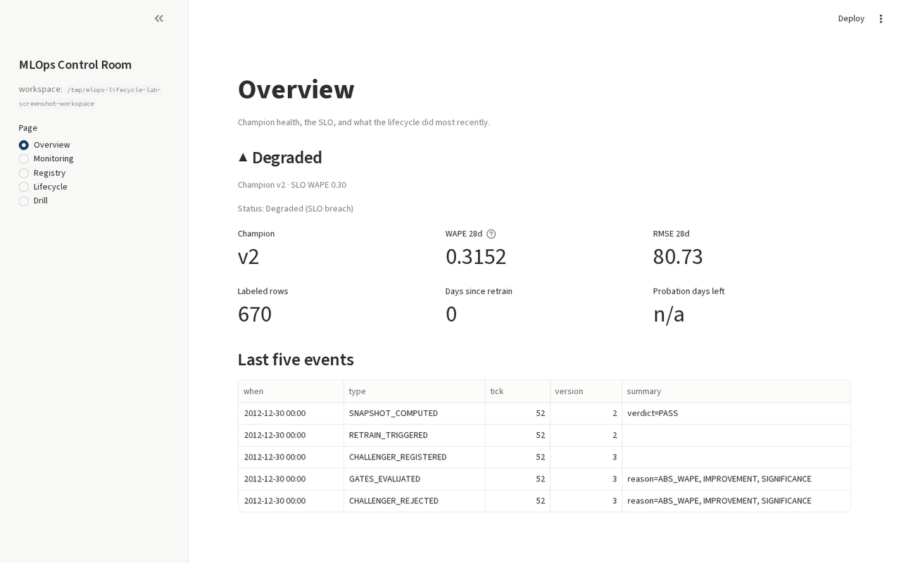
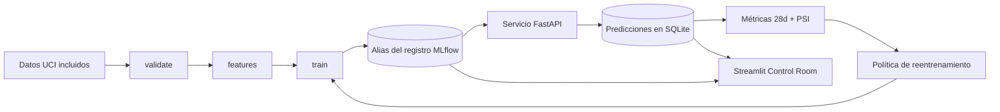

# mlops-lifecycle-lab

[](https://github.com/Eduardo12Pacheco/laboratorio-mlops/actions/workflows/ci.yml)
[](https://github.com/Eduardo12Pacheco/laboratorio-mlops/releases)
[](LICENSE)
[](pyproject.toml)

**Un ciclo de vida MLOps completo y local sobre datos reales de alquiler de bicicletas por
hora:** validación → features compartidas → entrenamiento trazado → registro
campeón/retador → servicio por lotes y online → registro de predicciones → monitoreo de
drift y rendimiento → reentrenamiento automático con compuertas estadísticas → probation y
rollback, demostrado con un drill reproducible.

> [English](README.md) · [Arquitectura](docs/ARCHITECTURE.md) · [Operación](docs/OPERATIONS.md) · [Model card](docs/MODEL_CARD.md) · [Datos](docs/DATA.md)



## Qué hace

- **Datos con contrato.** Un motor puro de validación ejecuta 13 reglas con nombre; un lote
  inválido se pone en cuarentena antes de puntuarse o registrarse (nunca una predicción
  mala silenciosa).
- **Una sola función de features.** Los caminos batch y online llaman al mismo
  `build_features` y una prueba de paridad demuestra que coinciden; las columnas de fuga
  nunca llegan al modelo.
- **Entrenamiento trazado y registro por alias.** MLflow guarda parámetros, métricas, tags,
  evidencia de compuertas y el modelo; el ciclo de vida vive en tags `mll.stage` y alias
  `champion`, `previous-champion` y `challenger`, nunca en etapas obsoletas.
- **Servicio con recarga en caliente.** Endpoints FastAPI para predicción individual, por
  lotes y etiquetas tardías, `/metrics` de Prometheus, request ids y un campeón que se
  intercambia de forma atómica.
- **Monitoreo honesto.** WAPE/RMSE/MAE/sesgo de los últimos 28 días con etiquetas se
  reportan aparte del PSI de covariables y predicciones contra la ventana de entrenamiento
  del campeón, así la estacionalidad se ve sin confundirse con daño al modelo.
- **Ciclo de vida automático.** Seis compuertas campeón/retador (validez, WAPE absoluto,
  ratio contra baseline, mejora, significancia por bootstrap de días y regresión por
  segmento), probation de 21 días, rollback automático, run ledger y un scheduler de replay
  resistente a reinicios.
- **Un Control Room terminado.** Cinco páginas, modo claro y oscuro, estados explícitos de
  carga/vacío/error y estado comunicado con ícono y etiqueta, nunca solo con color.

## Arquitectura



Python 3.12 tipado y hexagonal: `domain` puro, casos de uso `application` sobre puertos,
adaptadores para SQLite, MLflow, LightGBM, Evidently y HTTP, y una raíz de composición que
los conecta. La dirección de dependencias la verifica import-linter en CI; ver
[docs/ARCHITECTURE.md](docs/ARCHITECTURE.md) y los [ADRs](docs/adr/).

## Inicio rápido

Ruta Docker (Linux/macOS, requiere Docker ≥ 24 y Compose v2):

```bash
git clone https://github.com/Eduardo12Pacheco/laboratorio-mlops && cd laboratorio-mlops
./install.sh
# Abrir http://127.0.0.1:14501 (MLflow: http://127.0.0.1:14000)
```

Windows PowerShell:

```powershell
git clone https://github.com/Eduardo12Pacheco/laboratorio-mlops; cd laboratorio-mlops
.\install.ps1
# Abrir http://127.0.0.1:14501
```

L1 sin Docker (Python 3.12 + `uv`, sin clonar; cada release adjunta además el wheel):

```bash
uv tool install git+https://github.com/Eduardo12Pacheco/laboratorio-mlops
mll quickstart
mll dashboard
```

Ejecuta `./install.sh --check` (o `.\install.ps1 -Check`) para un informe de requisitos sin
efectos secundarios, y `mll doctor` para las mismas comprobaciones en la ruta L1.

## Resultados

Cada número proviene de un drill comprometido y reproducible (semilla 42, 52 semanas,
esquema `drill-report/v1`); ver [docs/results](docs/results) y
[docs/MODEL_CARD.md](docs/MODEL_CARD.md).

<!-- results:start -->
| Scenario | Weeks | Versions | Promotions | Rejections | Rollbacks | Quarantined | As-served RMSE | As-served MAE | As-served WAPE | Frozen-v1 RMSE | Frozen-v1 WAPE | RMSE ratio |
|---|---:|---:|---:|---:|---:|---:|---:|---:|---:|---:|---:|---:|
| drift | 52 | 3 | 1 | 1 | 0 | 0 | 70.7197 | 45.8888 | 0.1949 | 109.9249 | 0.3165 | 0.6433 |
| gate-reject | 24 | 3 | 1 | 1 | 0 | 0 | 66.8555 | 41.8600 | 0.1988 | 88.8282 | 0.2783 | 0.7526 |
| bad-batch | 12 | 1 | 0 | 0 | 0 | 1 | 70.3356 | 43.4195 | 0.2654 | 70.3356 | 0.2654 | 1.0000 |
| rollback | 25 | 3 | 2 | 0 | 1 | 0 | 84.8111 | 48.6398 | 0.2287 | 88.8369 | 0.2763 | 0.9547 |

_Generado por `uv run python scripts/render_results_table.py` desde `docs/results/drill-*.json` (semilla 42, esquema `drill-report/v1`); no editar a mano._
<!-- results:end -->

## El drift drill

```bash
mll drill run --scenario drift --weeks 52 --check
```

El drill reproduce 2012 semana a semana. Busca el disparo al final del 2012-04-01 (WAPE de
28 días `0.3086`), la v2 promovida (RMSE `53.27` contra `120.93` del campeón, mejora de 55.95%, cota
inferior del bootstrap `9000.84`), la probation superada tres ticks después y el retador
final rechazado al terminar el año. La automatización reduce el RMSE servido de 2012 de
`109.92` (v1 nunca reentrenada) a `70.72`. La línea de tiempo completa está en
[docs/results/drill-drift.md](docs/results/drill-drift.md); `--scenario all` ejecuta
`drift`, `gate-reject`, `bad-batch` y `rollback` en espacios de trabajo aislados.

Las capturas de cada página en ambos temas están en
[docs/assets/screenshots](docs/assets/screenshots) y se toman de la app real con
`scripts/capture_screenshots.py`.

## Limitaciones

- No es un servicio en la nube: sin Kubernetes, servicios gestionados, sistema de auth (solo
  una API key opcional de administración), servidor Grafana/Prometheus ni canary traffic
  splitting.
- La "producción" es un replay de la mitad 2012 del dataset; sin feed de datos en vivo ni
  feature store.
- El modelo es deliberadamente simple (un LightGBM Poisson, sin tuning/AutoML/deep
  learning); el producto es el ciclo de vida, no la precisión de benchmark.
- El PSI de drift es informativo y nunca dispara un reentrenamiento; solo lo hace el WAPE con
  etiquetas, por diseño: en cada semana de 2012 al menos la mitad de las 4 variables de clima supera
  PSI 0.2 (estacionalidad, no daño al modelo).
- El retador se evalúa en un holdout y se promueve sin reentrenar sobre él, así el artefacto
  promovido es exactamente el evaluado.
- Los artefactos ejecutan código al cargarse: el registro local es estado de confianza (ver
  [SECURITY.md](SECURITY.md)).
- Los números de referencia son de Linux x86_64; el punto flotante entre SO puede mover el
  tick de reentrenamiento una semana, algo que los tests golden toleran explícitamente.

## Licencia y datos

MIT © 2026 Eduardo Pacheco — ver [LICENSE](LICENSE).
Datos: UCI Bike Sharing (Fanaee-T, 2013), CC BY 4.0, DOI
[10.24432/C5W894](https://doi.org/10.24432/C5W894), incluidos sin cambios como gzip con sus
checksums y atribución en [docs/DATA.md](docs/DATA.md).
