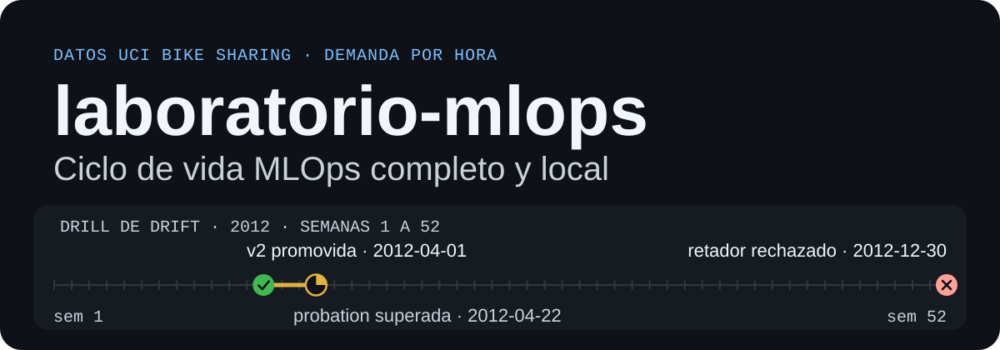
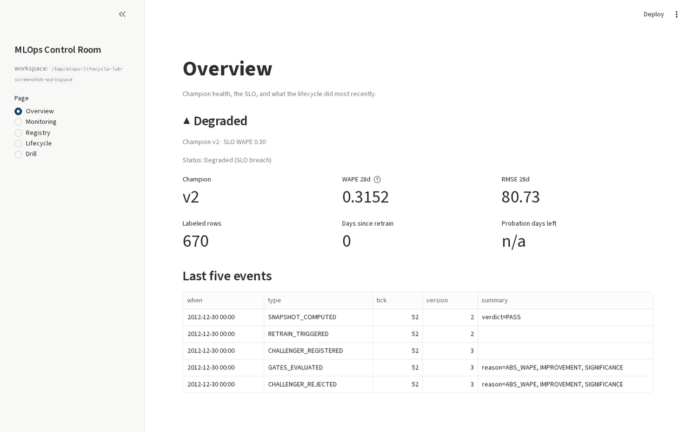
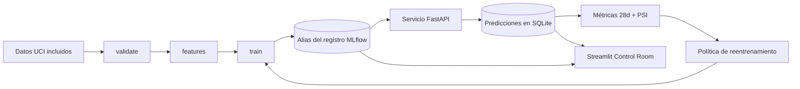

# laboratorio-mlops

**Español** · [English](README.en.md)

**Un ciclo de vida MLOps completo y local sobre demanda real de bicicletas por hora, con reentrenamiento automático y rollback demostrados por un drill reproducible.**

[](https://github.com/Eduardo12Pacheco/laboratorio-mlops/actions/workflows/ci.yml)
[](https://github.com/Eduardo12Pacheco/laboratorio-mlops/releases)
[](LICENSE)
[](pyproject.toml)

<p align="center">
  
</p>



## Qué es

Laboratorio de MLOps en Python 3.12 que recorre el ciclo completo sobre datos de alquiler de bicicletas: validar, compartir features, entrenar, registrar, servir, monitorear drift y reentrenar con compuertas estadísticas. Corre en local con Docker o con `uv`.

**Estado:** proyecto de portafolio con mantenimiento activo; versión 1.0.0 ([CHANGELOG](CHANGELOG.md)).

## Por qué es distinto

- **Datos con contrato.** Un motor de validación puro ejecuta 12 reglas con nombre; un lote inválido se pone en cuarentena antes de puntuarse o registrarse.
- **Una sola función de features.** Los caminos batch y online llaman al mismo `build_features`; una prueba de paridad lo demuestra y las columnas de fuga nunca llegan al modelo.
- **Promoción con compuertas.** Seis compuertas campeón/retador (validez, WAPE absoluto, ratio contra baseline, mejora, significancia por bootstrap de días y regresión por segmento), 21 días de probation y rollback automático.
- **Monitoreo separado.** WAPE, RMSE, MAE y sesgo con etiquetas se reportan aparte del PSI de covariables, así la estacionalidad no se confunde con daño al modelo.
- **Registro por alias.** MLflow guarda parámetros, métricas, evidencia de compuertas y el modelo; el ciclo de vida vive en tags `mll.stage` y en los alias `champion`, `previous-champion` y `challenger`, no en etapas obsoletas.

## Cómo funciona



Python 3.12 tipado con arquitectura hexagonal: `domain` puro, casos de uso `application` sobre puertos y adaptadores para SQLite, MLflow, LightGBM, Evidently y HTTP. Una raíz de composición los conecta; el servicio recarga el campeón de forma atómica y import-linter verifica la dirección de dependencias en CI. Detalle en [docs/ARCHITECTURE.md](docs/ARCHITECTURE.md) y los [ADRs](docs/adr/).

## Inicio rápido

Ruta Docker (Linux/macOS, requiere Docker ≥ 24 y Compose v2):

```bash
git clone https://github.com/Eduardo12Pacheco/laboratorio-mlops && cd laboratorio-mlops
./install.sh
# Abrir http://127.0.0.1:14501 (MLflow: http://127.0.0.1:14000)
```

Windows PowerShell:

```powershell
git clone https://github.com/Eduardo12Pacheco/laboratorio-mlops; cd laboratorio-mlops
.\install.ps1
# Abrir http://127.0.0.1:14501
```

Ruta sin Docker (Python 3.12 + `uv`, sin clonar; cada release adjunta además el wheel):

```bash
uv tool install git+https://github.com/Eduardo12Pacheco/laboratorio-mlops
mll quickstart
mll dashboard
```

`./install.sh --check` (o `.\install.ps1 -Check`) revisa requisitos sin efectos secundarios, y `mll doctor` hace las mismas comprobaciones en la ruta sin Docker.

## Resultados

Cada número sale de un drill comprometido y reproducible (semilla 42, 52 semanas, esquema `drill-report/v1`). Las filas se regeneran desde [docs/results](docs/results); no se editan a mano.

<!-- results:start -->
| Scenario | Weeks | Versions | Promotions | Rejections | Rollbacks | Quarantined | As-served RMSE | As-served MAE | As-served WAPE | Frozen-v1 RMSE | Frozen-v1 WAPE | RMSE ratio |
|---|---:|---:|---:|---:|---:|---:|---:|---:|---:|---:|---:|---:|
| drift | 52 | 3 | 1 | 1 | 0 | 0 | 70.7197 | 45.8888 | 0.1949 | 109.9249 | 0.3165 | 0.6433 |
| gate-reject | 24 | 3 | 1 | 1 | 0 | 0 | 66.8555 | 41.8600 | 0.1988 | 88.8282 | 0.2783 | 0.7526 |
| bad-batch | 12 | 1 | 0 | 0 | 0 | 1 | 70.3356 | 43.4195 | 0.2654 | 70.3356 | 0.2654 | 1.0000 |
| rollback | 25 | 3 | 2 | 0 | 1 | 0 | 84.8111 | 48.6398 | 0.2287 | 88.8369 | 0.2763 | 0.9547 |

_Generated by `uv run python scripts/render_results_table.py` from `docs/results/drill-*.json` (seed 42, schema `drill-report/v1`); do not edit by hand._
<!-- results:end -->

Reproducir el drift drill, 2012 semana a semana:

```bash
mll drill run --scenario drift --weeks 52 --check
```

El disparo llega al final del 2012-04-01 (WAPE de 28 días `0.3086`) y la v2 se promueve (RMSE `53.27` frente a `120.93` del campeón, mejora de 55.95%). Tres semanas después supera la probation y el retador final se rechaza el 2012-12-30. La automatización baja el RMSE servido de 2012 de `109.92` (v1 sin reentrenar) a `70.72`. Cronología completa en [docs/results/drill-drift.md](docs/results/drill-drift.md).

## Limitaciones honestas

- No es un servicio en la nube: sin Kubernetes, servicios gestionados, sistema de autenticación (solo una API key opcional de administración), servidor Grafana/Prometheus ni canary traffic splitting.
- La "producción" es un replay de la mitad 2012 del dataset; no hay feed de datos en vivo ni feature store.
- El modelo es deliberadamente simple (un LightGBM Poisson, sin tuning, AutoML ni deep learning); el producto es el ciclo de vida, no la precisión de benchmark.
- El PSI de drift es informativo y nunca dispara un reentrenamiento; solo lo hace el WAPE con etiquetas. En cada semana de 2012 al menos la mitad de las 4 variables de clima supera PSI 0.2: es estacionalidad, no daño al modelo.
- El retador se evalúa en un holdout y se promueve sin reentrenar sobre él, así el artefacto promovido es exactamente el evaluado.
- Los artefactos ejecutan código al cargarse: el registro local es estado de confianza (ver [SECURITY.md](SECURITY.md)).
- Los números de referencia son de Linux x86_64; diferencias de punto flotante entre sistemas operativos pueden mover un tick de reentrenamiento una semana, algo que los tests golden toleran explícitamente.

## Documentación

[Arquitectura](docs/ARCHITECTURE.md) · [Operación](docs/OPERATIONS.md) · [Model card](docs/MODEL_CARD.md) · [Datos](docs/DATA.md) · [ADRs](docs/adr/) · [Capturas](docs/assets/screenshots) · [Contribuir](CONTRIBUTING.md) · [Seguridad](SECURITY.md)

## Licencia y datos

MIT © 2026 Eduardo Pacheco — ver [LICENSE](LICENSE).
Datos: UCI Bike Sharing (Fanaee-T, 2013), CC BY 4.0, DOI [10.24432/C5W894](https://doi.org/10.24432/C5W894), incluidos sin cambios como gzip con sus checksums y atribución en [docs/DATA.md](docs/DATA.md).

## Autor

Eduardo Pacheco · https://github.com/Eduardo12Pacheco
