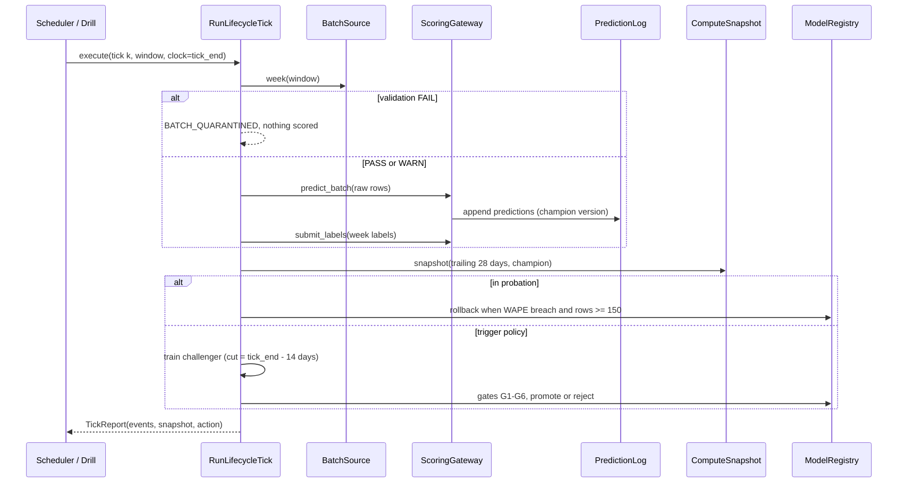
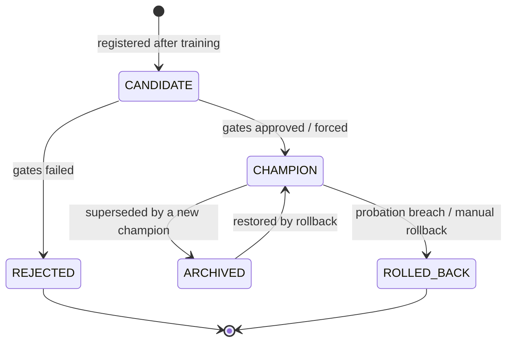

# Arquitectura

`mlops-lifecycle-lab` es un sistema de ciclo de vida MLOps local-first alrededor de un problema de
regresión: la demanda horaria de alquiler de bicicletas. El producto es el bucle —validar, construir
features, entrenar, evaluar compuertas, registrar, promover, servir, registrar predicciones, ingerir
etiquetas tardías, monitorear, decidir, reentrenar, revertir— y no el modelo en sí.

Los mismos casos de uso se ejecutan desde la CLI, el drill y el servicio APScheduler. Cada número de
la documentación proviene de un reporte comprometido en [`results/`](results/results-table.md) o de
un comando documentado, nunca de un notebook.

## Capas y la regla de dependencia

```
entrypoints  (CLI, FastAPI, Streamlit, drill)
bootstrap | config | logging_setup     composition root and cross-cutting wiring
adapters     (SQLite, MLflow, LightGBM, Evidently, APScheduler, HTTP client, clocks)
application  (ports, DTOs, pipeline, use cases)
domain       (pure: schema, validation, features, metrics, gates, policies, lifecycle)
```

Las importaciones apuntan solo hacia abajo. `domain` importa la biblioteca estándar, `numpy`,
`pandas` y `scipy`; no conoce MLflow, FastAPI, SQLite ni el sistema de archivos. `application`
depende de Protocols en [`ports.py`](../src/mlops_lifecycle_lab/application/ports.py) y nunca de un
adaptador concreto. Los `adapters` implementan puertos y no pueden importar a un adaptador hermano.
`bootstrap`, `config` y `logging_setup` son independientes entre sí, y solo `bootstrap` conecta
adaptadores concretos. Los `entrypoints` reciben un contenedor ya listo.

La regla se ejecuta, no solo se documenta:

- `uv run lint-imports` aplica el contrato de capas, un contrato de externos prohibidos para
  `domain`/`application` y la independencia de adaptadores. Imprime `Contracts: 3 kept, 0 broken.`
- [`tests/architecture/test_layers.py`](../tests/architecture/test_layers.py) planta una violación
  temporal `domain → adapters` y afirma que import-linter la reporta como rota, para que la compuerta
  no pueda desaparecer en silencio.

Ver [ADR-0001](adr/0001-hexagonal-architecture.md) y [ADR-0002](adr/0002-uv-python312-packaging.md).

## Mapa de módulos

| Ruta | Responsabilidad |
|---|---|
| `domain/schema.py` | contratos de columnas raw/label/feature, columnas de fuga, features monitoreadas |
| `domain/windows.py` | `TimeWindow` semiabierto y aritmética de ticks semanales |
| `domain/validation.py` | motor puro de contratos de datos con `PASS`/`WARN`/`FAIL` |
| `domain/features.py` | el `build_features` compartido que usan entrenamiento, batch y API |
| `domain/metrics.py` | RMSE, MAE, WAPE, sesgo |
| `domain/baseline.py` | baseline ingenuo de perfil `workingday × hour` |
| `domain/drift.py` | estadísticos PSI nativos y el resumen de drift |
| `domain/stats.py` | intervalo de confianza bootstrap pareado por bloques de días |
| `domain/gates.py` | seis compuertas de promoción y su evidencia |
| `domain/policies.py` | disparo de reentrenamiento, promoción campeón/retador inicial y probation |
| `domain/lifecycle.py` | máquina de estados del modelo de cinco etapas y `ModelVersion` |
| `domain/events.py` | eventos de auditoría del ciclo de vida tipados |
| `application/ports.py` | cada efecto secundario como Protocol |
| `application/pipeline.py` | `Step`/`Pipeline` con reintentos y filas en el run ledger |
| `application/services/` | bootstrap, entrenamiento, evaluación, promoción, scoring, monitoreo, tick |
| `adapters/storage/` | migraciones SQLite, log de predicciones, etiquetas, eventos, snapshots, KV, ledger |
| `adapters/tracking/` | tracking de experimentos y artefactos con MLflow |
| `adapters/registry/` | registro MLflow con tags y aliases |
| `adapters/models/` | entrenador LightGBM determinista |
| `adapters/data/` | dataset incluido, adquisición UCI, fuente de replay semanal |
| `adapters/drift/` | renderizador HTML de Evidently y su Null Object |
| `adapters/scheduling/` | loop de replay de APScheduler con cursor persistido |
| `adapters/serving_client/` | gateway HTTP de scoring |
| `bootstrap/container.py` | la única raíz de composición |
| `entrypoints/cli/` | comandos Typer (`mll ...`) |
| `entrypoints/api/` | fábrica de la app FastAPI, rutas, schemas, recarga en caliente, métricas |
| `entrypoints/dashboard/` | Control Room de Streamlit y view models testeables |
| `entrypoints/drill/` | motor de replay, cuatro escenarios, inyección de fallos, reportes |

## Puertos y adaptadores

| Puerto | Adaptador de producción | Doble de prueba |
|---|---|---|
| `Clock` | `SystemClock`, `SimulatedClock` | `SimulatedClock` |
| `BatchSource` | `ReplayBatchSource` sobre `BundledDataset` | frames en memoria |
| `LabeledDataRepository` | `CompositeLabeledData` (archivo + etiquetas de producción) | en memoria |
| `PredictionLog` | `SqlitePredictionLog` | `InMemoryPredictionLog` |
| `EventStore`, `SnapshotStore`, `KeyValueStore`, `RunLedger` | adaptadores SQLite | en memoria |
| `ExperimentTracker` | `MlflowTracker` | `InMemoryTracker` |
| `ModelRegistry` | `MlflowRegistry` | `InMemoryRegistry` |
| `ModelTrainer` | `LightGbmTrainer` | `FakeTrainer`, `PoisonedTrainer` (solo drill) |
| `DriftReportRenderer` | `EvidentlyReportRenderer` | `NullReportRenderer` |
| `ScoringGateway` | `InProcessGateway`, `HttpScoringGateway` | gateway en memoria |
| `ServingModelProvider` | `ModelHolder` de la API | predictor fijo |

Las suites de contrato compartidas del registro y del log de predicciones se ejecutan contra el fake
en memoria y contra el adaptador real, de modo que el puerto y el adaptador no puedan separarse en
silencio.

## Patrones y dónde se justifican

- **Hexagonal / puertos y adaptadores** — [`application/ports.py`](../src/mlops_lifecycle_lab/application/ports.py).
  Permite que el mismo ciclo de vida se ejecute en proceso en el drill y por HTTP en Compose.
- **Strategy** — [`domain/gates.py`](../src/mlops_lifecycle_lab/domain/gates.py) define un Protocol
  `Gate` con seis implementaciones intercambiables; `ModelTrainer` también es una estrategia. Se puede
  añadir nueva evidencia sin editar el servicio de evaluación.
- **Especificación / política componible** — `PromotionPolicy` evalúa cada compuerta y las combina
  con `all(...)`; `RetrainTriggerPolicy` codifica la matriz de decisión ordenada.
- **Máquina de estados** — [`domain/lifecycle.py`](../src/mlops_lifecycle_lab/domain/lifecycle.py)
  es dueña de las únicas transiciones legales de `ModelStage`; los adaptadores validan antes de escribir.
- **Repositorio + unidad de trabajo** — [`adapters/storage/`](../src/mlops_lifecycle_lab/adapters/storage)
  oculta el SQL detrás de puertos y expone `SqliteDatabase.transaction()`.
- **Factory + raíz de composición** — [`bootstrap/container.py`](../src/mlops_lifecycle_lab/bootstrap/container.py)
  es el único lugar que conoce las clases concretas.
- **Pipeline / comando** — [`application/pipeline.py`](../src/mlops_lifecycle_lab/application/pipeline.py)
  ejecuta pasos con nombre con reintentos y escribe cada intento en el run ledger.
- **Decorator** — `PoisonedTrainer` en [`entrypoints/drill/faults.py`](../src/mlops_lifecycle_lab/entrypoints/drill/faults.py)
  inyecta el fallo del escenario de rollback sin tocar el entrenamiento de producción.
- **Null Object** — `NullReportRenderer` mantiene libres de renderizado HTML a `--fast` y a las pruebas.
- **Eventos de dominio** — los eventos del ciclo de vida se añaden a SQLite y son la columna vertebral
  de auditoría del dashboard, del reporte del drill y de la aprobación de promociones.
- **View model** — [`entrypoints/dashboard/viewmodels.py`](../src/mlops_lifecycle_lab/entrypoints/dashboard/viewmodels.py)
  convierte puertos en modelos de lectura inmutables y testeables; las páginas se mantienen delgadas.

## Un tick del ciclo de vida



El orden completo es validación → scoring → etiquetas → snapshot → probation/decisión →
(entrenar → compuertas → promover/rechazar). Un lote `FAIL` nunca se puntúa, nunca escribe una
predicción y nunca entrena. Volver a ejecutar un tick ya completado no hace nada (`ALREADY_COMPLETED`).

## Ciclo de vida del modelo



`mll.stage` es un tag, no una etapa de MLflow (las etapas están obsoletas). Los aliases son
`champion`, `previous-champion` y `challenger`. Ver [ADR-0003](adr/0003-registry-aliases-not-stages.md).

## Flujo de datos y linaje

```text
UCI hour.csv (pinned sha256)
  └─ bundled hour.csv.gz (committed)
       ├─ bootstrap: rows < 2012-01-01
       ├─ replay: one week per tick, scored before its labels exist
       └─ training: archive ∪ labeled production rows, ts < cut

training frame (sorted) ── sha256(hash_pandas_object) ──► mll.data_fingerprint
        │                                                   │
        ├─ MLflow run: params, metrics, tags, artifacts      │
        │    validation_report.json / gate_report.json      │
        │    feature_columns.json / reference_predictions.json
        └─ registered version: mll stage, windows, run id, metrics

champion alias ──► ModelHolder ──► prediction log (features JSON + prediction)
                                        │
labels (entity_id) ─────────────────────┘
                                        ▼
                         labeled_predictions view
                                        │
                         snapshot (WAPE/RMSE/PSI) + audit events
```

Cada fila de predicción guarda las doce features, el nombre y la versión del modelo, la marca de tiempo
del evento, la marca de tiempo del scoring, la fuente y el request id. Las etiquetas se asocian por
`entity_id`; la vista `labeled_predictions` las une. La huella de datos, el run id y los tags del
registro hacen auditable la cadena datos → run → versión → predicción solo desde SQLite y MLflow.

## Modos de fallo

| Fallo | Comportamiento |
|---|---|
| Lote inválido | `BATCH_QUARANTINED`; la semana nunca se puntúa, se registra ni se entrena; la siguiente semana continúa con normalidad |
| Falla de la recarga en caliente | El predictor anterior sigue sirviendo; `mll_model_reload_failures_total` aumenta; la nueva versión se reintenta en el siguiente intervalo |
| Etiquetas tardías | La ventana se puntúa antes de que existan etiquetas; el monitoreo solo cuenta filas etiquetadas del campeón actual |
| Reinicio del scheduler | El cursor vive en el KV de SQLite y solo avanza tras completar un tick; un reinicio continúa en `cursor + 1` |
| Lock de SQLite | Modo WAL, `busy_timeout=5000`, una conexión con un `RLock`; los hilos de trabajo del servicio la comparten de forma segura |
| MLflow no disponible | Entrenamiento y evaluación fallan de forma visible y quedan registrados en el ledger; el servicio conserva el campeón cargado |
| Sin campeón | `/readyz` devuelve 503 y los endpoints de predicción devuelven 503, hasta que bootstrap/init termina |
| Evidently no disponible | `--fast` y las pruebas usan el renderizador Null; el PSI nativo es independiente de Evidently |
| Workspace corrupto | El dashboard muestra un estado de error con un mensaje seguro y detalle técnico, no solo un stack trace |

## Puntos de extensión

- Un nuevo estadístico de drift: añadir una función pura en `domain/drift.py` y exponerla en
  `DriftSummary`; Evidently sigue siendo un renderizador opcional.
- Una nueva compuerta: implementar el Protocol `Gate` y añadirla a la lista de la política; el reporte
  y el dashboard la recogen mediante la serialización existente.
- Un nuevo flavor de modelo: implementar `ModelTrainer` y registrarlo mediante los mismos puertos
  `Predictor`/`ModelRegistry`, independientes del flavor.
- Una nueva fuente de lotes: implementar `BatchSource`; el tick y el drill no cambian.
- Un nuevo front end: consumir los view models del dashboard o la API; no se mueve código de dominio.

## Estrategia de pruebas

La pirámide es explícita y los marcadores forman parte del contrato:

- **Unitarias** — dominio y aplicación con fakes en memoria; propiedades de hypothesis para métricas,
  PSI, invariantes de métricas, compuertas, bootstrap y la máquina de estados.
- **Contrato** — la misma suite corre contra el fake y contra el registro y el log de predicciones reales.
- **Integración** — SQLite en un workspace temporal, SQLite de MLflow, `TestClient` de FastAPI,
  uvicorn en un puerto de loopback, APScheduler, Evidently.
- **End-to-end** (`slow`) — los cuatro escenarios del drill y los comandos de la CLI.
- **Calidad** — la compuerta de calidad bootstrap S5 y los números de aceptación del drill de drift.
- **UI** (`ui`) — Streamlit AppTest más capturas de Playwright del dashboard real.
- **Docker** (`docker`) — el smoke real de Compose a través de `scripts/smoke_compose.sh`.
- **Arquitectura** — positivos de import-linter y una prueba negativa con violación plantada.

`pytest-socket` bloquea los sockets que no son de loopback en todas las pruebas, la telemetría está
desactivada y todas las semillas están fijadas. CI aplica `ruff`, `mypy --strict` sobre `src/`,
import-linter, `uv lock --check`, cobertura ≥ 85% y `pip-audit`/gitleaks. Ver
[CONTRIBUTING.md](../CONTRIBUTING.md) para los comandos exactos.
