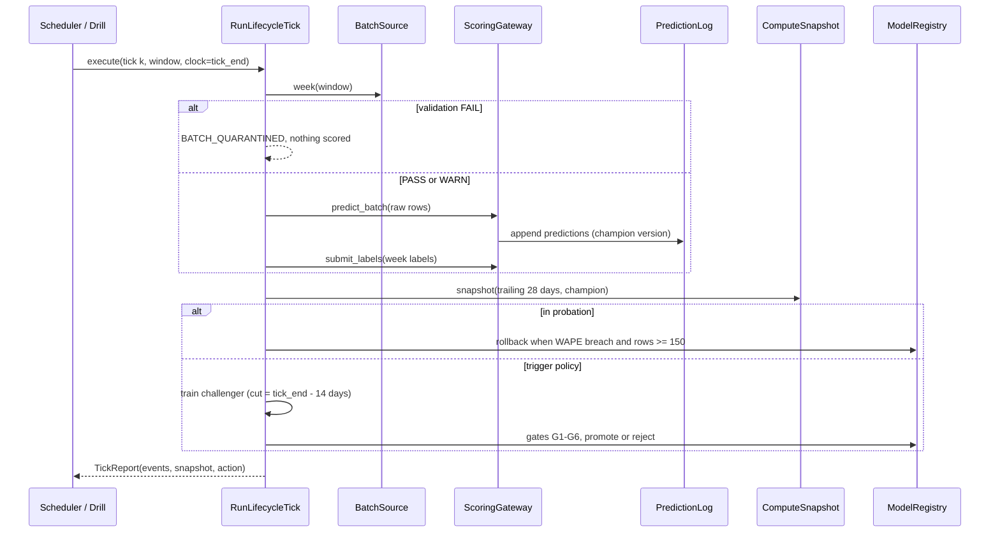
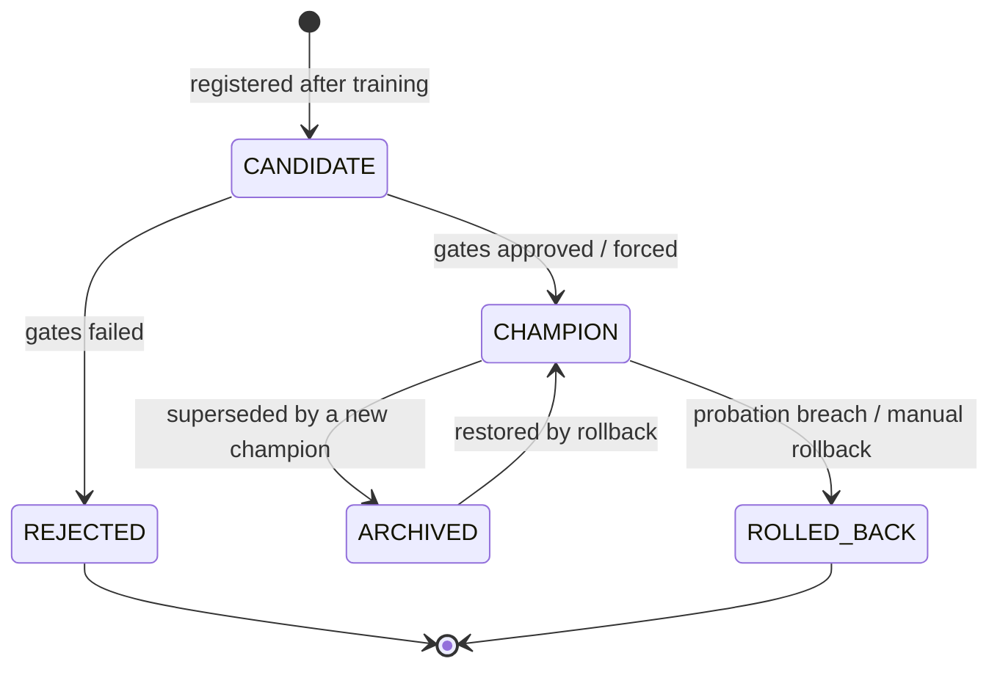

# Architecture

`mlops-lifecycle-lab` is a local-first MLOps lifecycle system around one regression
problem: hourly bike-rental demand. The product is the loop — validate, build features,
train, evaluate gates, register, promote, serve, log predictions, ingest delayed labels,
monitor, decide, retrain, roll back — not the model itself.

The same use cases run from the CLI, the drill and the APScheduler service. Every number
in the docs comes from a committed report under [`results/`](results/results-table.md) or
from a documented command, never from a notebook.

## Layers and the dependency rule

```
entrypoints  (CLI, FastAPI, Streamlit, drill)
bootstrap | config | logging_setup     composition root and cross-cutting wiring
adapters     (SQLite, MLflow, LightGBM, Evidently, APScheduler, HTTP client, clocks)
application  (ports, DTOs, pipeline, use cases)
domain       (pure: schema, validation, features, metrics, gates, policies, lifecycle)
```

Imports point downwards only. `domain` imports the standard library, `numpy`, `pandas`
and `scipy`; it knows nothing about MLflow, FastAPI, SQLite or the filesystem.
`application` depends on Protocols in [`ports.py`](../src/mlops_lifecycle_lab/application/ports.py)
and never on a concrete adapter. `adapters` implement ports and may not import a sibling
adapter. `bootstrap`, `config` and `logging_setup` are independent of each other and only
`bootstrap` wires concrete adapters. `entrypoints` receive a ready container.

The rule is executed, not documented-only:

- `uv run lint-imports` enforces the layer contract, a forbidden-external contract for
  `domain`/`application`, and adapter independence. It prints `Contracts: 3 kept, 0 broken.`
- [`tests/architecture/test_layers.py`](../tests/architecture/test_layers.py) plants a
  temporary `domain → adapters` violation and asserts import-linter reports it broken, so
  the gate cannot silently disappear.

See [ADR-0001](adr/0001-hexagonal-architecture.md) and
[ADR-0002](adr/0002-uv-python312-packaging.md).

## Module map

| Path | Responsibility |
|---|---|
| `domain/schema.py` | raw/label/feature column contracts, leakage columns, monitored features |
| `domain/windows.py` | half-open `TimeWindow` and weekly tick arithmetic |
| `domain/validation.py` | pure data-contract engine with `PASS`/`WARN`/`FAIL` |
| `domain/features.py` | the one shared `build_features` used by training, batch and API |
| `domain/metrics.py` | RMSE, MAE, WAPE, bias |
| `domain/baseline.py` | naive `workingday × hour` profile baseline |
| `domain/drift.py` | native PSI statistics and the drift summary |
| `domain/stats.py` | day-block paired bootstrap confidence interval |
| `domain/gates.py` | six promotion gates and their evidence |
| `domain/policies.py` | retrain trigger, first-champion/challenger promotion, probation |
| `domain/lifecycle.py` | five-stage model state machine and `ModelVersion` |
| `domain/events.py` | typed lifecycle audit events |
| `application/ports.py` | every side effect as a Protocol |
| `application/pipeline.py` | retrying `Step`/`Pipeline` with run-ledger rows |
| `application/services/` | bootstrap, training, evaluation, promotion, scoring, monitoring, tick |
| `adapters/storage/` | SQLite migrations, prediction log, labels, events, snapshots, KV, ledger |
| `adapters/tracking/` | MLflow experiment tracking and artifacts |
| `adapters/registry/` | MLflow registry with tags and aliases |
| `adapters/models/` | deterministic LightGBM trainer |
| `adapters/data/` | bundled dataset, UCI acquisition, weekly replay source |
| `adapters/drift/` | Evidently HTML renderer and its Null Object |
| `adapters/scheduling/` | APScheduler replay loop with a persisted cursor |
| `adapters/serving_client/` | HTTP scoring gateway |
| `bootstrap/container.py` | the only composition root |
| `entrypoints/cli/` | Typer commands (`mll ...`) |
| `entrypoints/api/` | FastAPI app factory, routes, schemas, hot reload, metrics |
| `entrypoints/dashboard/` | Streamlit Control Room and testable view models |
| `entrypoints/drill/` | replay engine, four scenarios, fault injection, reports |

## Ports and adapters

| Port | Production adapter | Test double |
|---|---|---|
| `Clock` | `SystemClock`, `SimulatedClock` | `SimulatedClock` |
| `BatchSource` | `ReplayBatchSource` over `BundledDataset` | in-memory frames |
| `LabeledDataRepository` | `CompositeLabeledData` (archive + production labels) | in-memory |
| `PredictionLog` | `SqlitePredictionLog` | `InMemoryPredictionLog` |
| `EventStore`, `SnapshotStore`, `KeyValueStore`, `RunLedger` | SQLite adapters | in-memory |
| `ExperimentTracker` | `MlflowTracker` | `InMemoryTracker` |
| `ModelRegistry` | `MlflowRegistry` | `InMemoryRegistry` |
| `ModelTrainer` | `LightGbmTrainer` | `FakeTrainer`, `PoisonedTrainer` (drill only) |
| `DriftReportRenderer` | `EvidentlyReportRenderer` | `NullReportRenderer` |
| `ScoringGateway` | `InProcessGateway`, `HttpScoringGateway` | in-memory gateway |
| `ServingModelProvider` | API `ModelHolder` | fixed predictor |

The shared registry and prediction-log contract suites run against both the in-memory fake
and the real adapter, so the port and the adapter cannot drift apart silently.

## Patterns and where they earn their place

- **Hexagonal / ports and adapters** — [`application/ports.py`](../src/mlops_lifecycle_lab/application/ports.py).
  Lets the same lifecycle run in-process in the drill and through HTTP in Compose.
- **Strategy** — [`domain/gates.py`](../src/mlops_lifecycle_lab/domain/gates.py) defines a
  `Gate` Protocol with six interchangeable implementations; `ModelTrainer` is a strategy
  too. New evidence can be added without editing the evaluation service.
- **Specification / composable policy** — `PromotionPolicy` evaluates every gate and
  combines `all(...)`; `RetrainTriggerPolicy` encodes the ordered decision matrix.
- **State machine** — [`domain/lifecycle.py`](../src/mlops_lifecycle_lab/domain/lifecycle.py)
  owns the only legal `ModelStage` transitions; adapters validate before writing.
- **Repository + unit of work** — [`adapters/storage/`](../src/mlops_lifecycle_lab/adapters/storage)
  hides SQL behind ports and exposes `SqliteDatabase.transaction()`.
- **Factory + composition root** — [`bootstrap/container.py`](../src/mlops_lifecycle_lab/bootstrap/container.py)
  is the single place that knows concrete classes.
- **Pipeline / command** — [`application/pipeline.py`](../src/mlops_lifecycle_lab/application/pipeline.py)
  runs named steps with retries and writes every attempt to the run ledger.
- **Decorator** — `PoisonedTrainer` in [`entrypoints/drill/faults.py`](../src/mlops_lifecycle_lab/entrypoints/drill/faults.py)
  injects the rollback-scenario fault without touching production training.
- **Null Object** — `NullReportRenderer` keeps `--fast` and tests free of HTML rendering.
- **Domain events** — lifecycle events are appended to SQLite and are the audit backbone
  for the dashboard, the drill report and promotion approval.
- **View model** — [`entrypoints/dashboard/viewmodels.py`](../src/mlops_lifecycle_lab/entrypoints/dashboard/viewmodels.py)
  turns ports into frozen, testable read models; pages stay thin.

## One lifecycle tick



The full order is validation → scoring → labels → snapshot → probation/decision →
(train → gates → promote/reject). A FAIL batch never scores, never writes a prediction and
never trains. Re-running an already completed tick is a no-op (`ALREADY_COMPLETED`).

## Model lifecycle



`mll.stage` is a tag, not an MLflow stage (stages are deprecated). Aliases are
`champion`, `previous-champion` and `challenger`. See
[ADR-0003](adr/0003-registry-aliases-not-stages.md).

## Data flow and lineage

```text
UCI hour.csv (pinned sha256)
  └─ bundled hour.csv.gz (committed)
       ├─ bootstrap: rows < 2012-01-01
       ├─ replay: one week per tick, scored before its labels exist
       └─ training: archive ∪ labeled production rows, ts < cut

training frame (sorted) ── sha256(hash_pandas_object) ──► mll.data_fingerprint
        │                                                   │
        ├─ MLflow run: params, metrics, tags, artifacts      │
        │    validation_report.json / gate_report.json      │
        │    feature_columns.json / reference_predictions.json
        └─ registered version: mll stage, windows, run id, metrics

champion alias ──► ModelHolder ──► prediction log (features JSON + prediction)
                                        │
labels (entity_id) ─────────────────────┘
                                        ▼
                         labeled_predictions view
                                        │
                         snapshot (WAPE/RMSE/PSI) + audit events
```

Every prediction row stores the twelve features, model name/version, event timestamp,
score timestamp, source and request id. Labels attach by `entity_id`; the
`labeled_predictions` view joins them. The data fingerprint, run id and registry tags make
the chain data → run → version → prediction auditable from SQLite and MLflow alone.

## Failure modes

| Failure | Behaviour |
|---|---|
| Invalid batch | `BATCH_QUARANTINED`; the week is never scored, logged or trained on; next week continues normally |
| Hot-reload failure | Previous predictor keeps serving; `mll_model_reload_failures_total` increments; the new version is retried next interval |
| Delayed labels | The window is scored before labels exist; monitoring only counts labeled rows of the current champion |
| Scheduler restart | The cursor lives in SQLite KV and only advances after a completed tick; a restart continues at `cursor + 1` |
| SQLite lock | WAL mode, `busy_timeout=5000`, one connection with an `RLock`; serving worker threads share it safely |
| MLflow unavailable | Training/evaluation fail loudly and are recorded in the ledger; serving keeps the loaded champion |
| No champion | `/readyz` returns 503 and predict endpoints return 503 until bootstrap/init completes |
| Evidently unavailable | `--fast` / tests use the Null renderer; native PSI is independent of Evidently |
| Corrupt workspace | The dashboard shows an error state with a safe message and technical detail, not a stack trace alone |

## Extension points

- A new drift statistic: add a pure function in `domain/drift.py` and surface it in
  `DriftSummary`; Evidently stays an optional renderer.
- A new gate: implement the `Gate` Protocol and add it to the policy list; the report and
  dashboard pick it up through the existing serialisation.
- A new model flavour: implement `ModelTrainer` and register through the same
  flavor-agnostic `Predictor`/`ModelRegistry` ports.
- A new batch source: implement `BatchSource`; the tick and drill do not change.
- A new front end: consume the dashboard view models or the API; no domain code moves.

## Testing strategy

The pyramid is explicit and the markers are part of the contract:

- **Unit** — domain and application with in-memory fakes; hypothesis properties for
  metrics, PSI, metrics invariants, gates, bootstrap and the state machine.
- **Contract** — the same suite runs against fake and real registry / prediction log.
- **Integration** — SQLite in a temp workspace, MLflow SQLite, FastAPI `TestClient`,
  uvicorn on a loopback port, APScheduler, Evidently.
- **End-to-end** (`slow`) — the four drill scenarios and the CLI commands.
- **Quality** — the S5 bootstrap quality gate and the drift-drill acceptance numbers.
- **UI** (`ui`) — Streamlit AppTest plus Playwright screenshots of the real dashboard.
- **Docker** (`docker`) — the real Compose smoke through `scripts/smoke_compose.sh`.
- **Architecture** — import-linter positives and a planted-violation negative test.

`pytest-socket` blocks non-loopback sockets in every test, telemetry is disabled and all
seeds are fixed. CI enforces `ruff`, `mypy --strict` on `src/`, import-linter,
`uv lock --check`, coverage ≥ 85% and `pip-audit`/gitleaks. See
[CONTRIBUTING.md](../CONTRIBUTING.md) for the exact commands.
